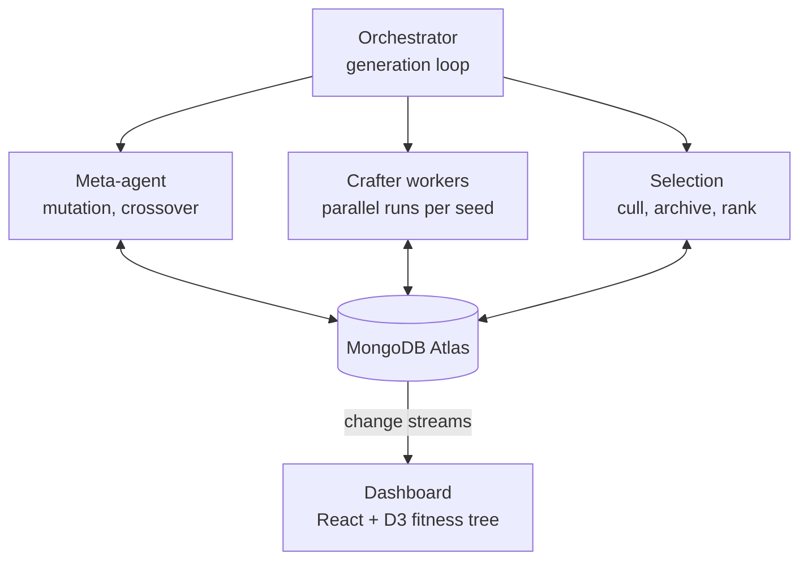

# Harness Darwinism on Crafter

A genetic-algorithm approach to **recursive harnessing**: a population of agent harnesses competes, breeds, and mutates on the Crafter survival game, with MongoDB Atlas as the memory and lineage layer.

---

## 1. Hackathon context

**Statement 1: Recursive Harnessing.** Build a self-improving agent harness that evolves its own architecture: rules, context policies, guardrails, tool access. How can agents adapt their whole environment to a specific user, task, or use case?

**Statement 2: Long Horizon Engineering.** Harnesses that sustain coherent memory over very long sessions and optimize toward long-term goals using hard metric signals.

**Constraints**
- Only one theme can be chosen. **Chosen: Statement 1.**
- A MongoDB sponsor integration is compulsory.

**Why Statement 1.** Harness evolution is its native subject, runs are short (so many generations fit in a hackathon), and the long-horizon material (sleep cycles, a long proof task) was cut to keep scope tight.

---

## 2. Core idea

> We don't write the agent's playbook. We let playbooks compete, breed, and learn from their mistakes, until one is better than anything we would have written.

- The **LLM is frozen.** Only the **harness** changes.
- A harness variant is a **genome**: system prompt, rules, tool list, memory policy, context budget.
- A population of genomes plays Crafter. Fitness comes from the game's own score.
- An LLM **meta-agent** performs crossover and trace-driven mutation.
- Weak variants are **archived**, not deleted, and can be sampled as parents later (borrowed from the Darwin Gödel Machine, section 8).

---

## 3. Environment: Crafter

Crafter is a 2D Minecraft-like survival benchmark (Hafner, 2021).

| Property | Detail |
|---|---|
| World | Procedurally generated top-down map, a different world per seed |
| Survival | Health, food, water, energy; zombies and skeletons; day/night cycle |
| Goal | Unlock 22 achievements along a tech tree (wood, table, pickaxe, stone, coal, furnace, iron tools, diamond) |
| Score | Per-achievement success rates combined into one standard score |
| Interface | Image or text observations; 17 discrete actions. A text-only version exists in BALROG |

**Why Crafter**
- Cheap, fast episodes give many generations.
- Scoring is automatic and comparable to published numbers.
- It is visual enough to demo, and rules like "craft a pickaxe first" show up directly in the score.

**Alternatives considered:** SWE-bench, tau-bench, Terminal-Bench, BFCL, text-to-SQL, Micropolis, Caesar III, Pokemon Red, OpenTTD.
OpenTTD stays a stretch goal. A package called `nttd` wraps an OpenTTD 15.3 dedicated server as a JSON API with a Gym environment, but it is early (v0.0.6) and its run speed is unverified. Keep everything behind one `evaluate(genome, seeds)` interface so a second environment can be swapped in.

---

## 4. The genome (harness variant)

One variant is one document. All variants share the same model and task; only the genome differs.

```json
{
  "_id": "h_g3_07",
  "generation": 3,
  "parents": ["h_g2_02", "h_g2_05"],
  "status": "alive",
  "genome": {
    "system_prompt": "You are a Crafter agent. Survive and unlock achievements.",
    "rules": [
      "Collect wood before anything else",
      "Sleep when energy is low and no enemies are near"
    ],
    "tools": ["move", "collect", "craft", "place", "sleep", "attack"],
    "memory_policy": { "type": "notes", "max_items": 20 },
    "context_budget": { "history_steps": 10 }
  },
  "fitness": { "score": 0.41, "cost": 1.2 },
  "mutation_note": "Added sleep rule after trace showed death at night"
}
```

**Designing the starting rules**
- **Option A (recommended for generation 0):** hand-write 3-5 candidate rules and give each starting variant a different random subset (some get all, some get one, some get none).
- **Option B:** have the meta-agent propose varied rule lists (one cautious, one aggressive, one exploratory).
- Rules are plain-English sentences inserted into the system prompt under a "strategy tips" heading.
- Every variant has its **own** rule list from the start. Tools and memory policy can be held fixed at first to isolate rule evolution.

---

## 5. GA mechanics

### 5.1 Parameters (defaults)

| Parameter | Value |
|---|---|
| Population size | 10 (constant every generation) |
| Survivors per generation | 5 |
| Children per generation | 5 |
| Training seed pool | ~30 seeds |
| Seeds sampled per generation | ~5 (identical for all variants in that generation) |
| Held-out test seeds | ~30, never seen in evolution |
| Stop condition | Fixed generation count, budget cap, or no best-score gain for 2 generations |

### 5.2 One generation

1. **Evaluate.** Each of the 10 genomes plays the 5 sampled seeds (50 games). Fitness = mean score across seeds, minus a small cost penalty.
2. **Select.** Rank by fitness. The top 5 survive as parents. The bottom 5 move to the **archive** (they are not counted in the active population but remain in the database).
3. **Pair.** 5 parents give C(5,2) = 10 possible pairs. Choose 5 pairs weighted by fitness, with some randomness to preserve diversity. Occasionally sample a parent from the archive.
4. **Crossover.** An LLM merges two parents' genomes (for example, A's crafting rules with B's survival rules).
5. **Mutate.** The LLM reads a parent's failed-game trace and proposes a targeted edit (for example, "died at night" leads to the rule "sleep when energy is low"). Candidate edits are checked against the ledger of already-tried ideas.
6. **Refill.** 5 survivors + 5 children = 10, so the population size stays constant.
7. **Repeat** with a fresh sample of training seeds.

> Note: the population must **not** shrink each generation. Keep 5, breed 5, refill to 10.

### 5.3 Pseudocode

```python
population = seed_variants(n=10)            # generation 0
archive = []

for gen in range(MAX_GEN):
    seeds = sample(TRAIN_SEEDS, k=5)
    for g in population:
        g.fitness = mean(play_crafter(g, s) for s in seeds) - cost_penalty(g)

    ranked = sorted(population, key=lambda g: g.fitness, reverse=True)
    parents, culled = ranked[:5], ranked[5:]
    archive.extend(culled)                  # kept, never deleted

    children = []
    while len(children) < 5:
        a, b = weighted_pair(parents, archive_ratio=0.1)
        child = llm_crossover(a, b)
        child = llm_mutate(child, failure_traces(a, b))
        if not ledger.seen(child.edit_hash):
            ledger.add(child.edit_hash)
            children.append(child)

    population = parents + children         # size stays 10
```

### 5.4 Why it is a real GA

Genome, fitness-based selection, crossover, mutation, and a constant-size population are all present. The only twist is that mutation is **LLM-guided** (reads failure traces) rather than random, which is why a ledger and held-out evaluation are needed to keep it honest.

---

## 6. Showing that evolution actually helps

**What changes vs. what is fixed.** Same frozen model, same Crafter settings, same worlds. The genome is the only variable. Within an episode the agent adapts through its context, but that applies equally to every variant. Cross-episode learning can only come from the harness (for example, a memory gene).

**Evidence**
1. **Held-out seeds.** After evolution, run the baseline and the champion on ~30 unseen seeds (paired seeds). Report mean score with confidence intervals.
2. **Ablation arms at equal LLM-call budget:**
   - Baseline (hand-written harness)
   - Random mutation (no trace reading, no selection)
   - Hill-climbing (single lineage, no population)
   - Full system (population + crossover + archive)
3. **Champion ablation.** Remove one evolved rule at a time and re-run. A score drop attributes the gain to that rule.
4. **Per-edit delta.** Store the parent-to-child score change on every mutation, so lineage shows which edits helped.
5. **Per-achievement breakdown.** For example, "iron pickaxe: 0% to 60%", tied to the rule that caused it.
6. **Noise control.** Several seeds per variant; report variance.
7. **No contamination.** The meta-agent never sees traces from held-out seeds.

**Seed strategy.** Reusing the same seeds every generation overfits to specific maps; fresh seeds every generation is noisy. Sampling a few from a pool each generation (identical within a generation) balances both.

---

## 7. System design and MongoDB

### 7.1 Architecture



### 7.2 Collections

| Collection | Purpose |
|---|---|
| `harnesses` | Genomes, parents, status (`alive` / `archived` / `champion`), fitness, mutation note. `$graphLookup` traces lineage |
| `runs` | Per variant and seed: score, achievements, steps, trace, failure summary |
| `ledger` | Hash of every tried mutation (unique index) so failed ideas are never retried |
| `metrics` | Time series of best and mean score per generation (the climbing curve) |
| Vector Search index | Embeddings of failure summaries; the meta-agent retrieves similar past failures and the edits that fixed them |
| Change streams | Push live updates to the dashboard fitness tree |

Tag documents with an `arm` field so all ablation arms live in one database and one dashboard.

### 7.3 Evolution trigger

The orchestrator, not the agents, triggers evolution. When every variant in generation N has its expected number of `runs`, it computes fitness, selects, calls the meta-agent for each child, checks the ledger, inserts children into `harnesses`, and queues generation N+1. (Optionally use a change stream on `runs` to start the next generation the moment the last run lands.)

### 7.4 Atlas Agent Engine: natural or forced?

Atlas Agent Engine is in public preview. From the product page it offers natively managed long-term memory (semantic, episodic, taxonomic, procedural), Voyage AI retrieval, sandboxed per-identity tool calls, org-level governance policies, and a runtime that traces every model, tool, and memory call. It is open across models and frameworks (MCP, A2A, OpenTelemetry).

**Test for "natural":** if you deleted the engine, would the evolved genes stop existing? Today they would not, so most integrations are forced.

| Integration | Verdict |
|---|---|
| Engine memory as an evolvable gene (on/off, which types, how much to store and retrieve) | Natural. The only cross-episode learning channel, and it can be ablated |
| Engine traces (including memory accesses) as meta-agent evidence | Natural. Shows which memories helped or misled |
| Deploying every variant as a managed agent | Forced. A variant is just config |
| Governance and identity | Mostly forced for a game. Use only for cost caps and sandboxing |
| Replacing lineage, ledger, metrics collections | Forced. Plain Atlas fits better |

**To make it natural:** make the engine's own knobs part of the genome (memory types, retrieval count, allowed tools), and prove value with an ablation: no memory vs. default engine memory vs. evolved memory policy on held-out worlds.

**Open items to verify in the docs:** that memory, tool access, and policies can be configured per agent programmatically; run and trace APIs; and whether any evaluation features exist. Episode fitness does not need the engine: Crafter's own achievement score is the objective metric, stored in Atlas. If the engine integration stalls, fall back to the plain Atlas design.

---

## 8. Related work: Darwin Gödel Machine (Sakana AI / UBC)

**Citation.** Zhang, J., Hu, S., Lu, C., Lange, R., & Clune, J. (2025). *Darwin Godel Machine: Open-Ended Evolution of Self-Improving Agents.* arXiv:2505.22954. https://arxiv.org/abs/2505.22954. Code: https://github.com/jennyzzt/dgm

**Idea.** Schmidhuber's Gödel Machine (2007) is a theoretical self-improving AI that only rewrites itself after *proving* the change is beneficial, which is impractical. The DGM relaxes the proof requirement and instead requires *empirical evidence* from experiments that a new version performs better. It defines self-improvement as a coding task: the agent modifies its own code (its tools, workflows, prompts), while the underlying foundation model stays fixed. It also keeps an **archive** of every agent it discovers, so it explores many paths rather than hill-climbing one solution.

**Algorithm (high level)**
1. Start with a single initial coding agent and put it in the archive.
2. **Select a parent** from the archive. Selection favors higher-performing agents and agents with fewer children, so promising but under-explored branches get attention. (Exact weighting is in the paper's method section; verify there before quoting it.)
3. **Self-modify.** The foundation model reads the parent's benchmark logs, proposes an improvement to its own code, and implements it, producing a child agent.
4. **Evaluate** the child on coding benchmarks (SWE-bench, Polyglot).
5. **Archive** the child if it is valid and still able to edit code, *even if it scores lower than its parent*, since weaker agents can be stepping stones.
6. Repeat, growing a tree of diverse agents in parallel.

**Reported results.** Self-improvement lifted SWE-bench from roughly 20% to 50%, with similar gains on Polyglot (check the paper for exact figures). The paper reports that variants without self-improvement or without open-ended exploration (the archive) did significantly worse.

**Safety notes.** Runs were sandboxed with lineage tracking; the authors also report the agent occasionally gaming its own evaluation, which motivates held-out tests and ledgers.

### How our system relates

| | DGM | Harness Darwinism (ours) |
|---|---|---|
| What evolves | The agent's own Python code | A config genome: prompt, rules, tools, memory policy, context budget |
| Who edits | The agent rewrites itself | A separate meta-agent edits genomes |
| Population | One growing tree, sampled one parent at a time | A generation of 10 competing variants |
| Crossover | None | Two-parent merge |
| Archive | Keeps all agents | Keeps culled variants as `archived`, sampled as parents |
| Task | SWE-bench, Polyglot | Crafter |
| Risk | Self-modifying code needs heavy sandboxing | Config edits are much safer |

**Pitch line.** "DGM showed that an archive plus empirical testing lets agents improve themselves. We apply that to the whole harness (rules, tools, memory, context), add population-based crossover, and use MongoDB as the lineage and memory layer."

---

## 9. Demo plan

1. **Side-by-side replay** on the same world: generation-0 baseline vs. evolved champion.
2. **Live fitness tree** (branches grow and die) and a climbing best/mean score curve, fed by change streams.
3. **Achievement grid** of the 22 achievements, mostly gray for the baseline and mostly lit for the champion.
4. **Champion's evolved rules** on screen next to the score they caused.
5. **Held-out worlds** to show generalization, plus the ablation chart (baseline, random mutation, hill-climbing, full system).
6. **Backup:** pre-record the best run in case the live demo is slow.

---

## 10. Explain it to a 15-year-old

Imagine a video game where you survive in a world, gather wood, craft tools, and avoid zombies. You hire an AI to play, but it needs a **playbook** of tips like "get wood first" and "sleep when tired." Writing a good playbook by hand is hard, so we let playbooks **evolve**.

- **Round 1:** 10 different playbooks each play a few practice worlds and get a score.
- **Selection:** The top 5 survive. The bottom 5 go on a shelf (a "bad" idea sometimes turns out useful later).
- **Breeding:** Combine two winners. One is great at crafting and one at surviving, so the child gets both.
- **Learning from mistakes:** A helper AI watches a failed game, notices "it died at night," and adds the rule "sleep when you're tired."
- **Repeat.** The team stays at 10 players; scores climb.
- **Final exam:** Test the best playbook on brand-new worlds it has never seen. If it still wins, it really got smarter.

MongoDB is the family album and notebook: every playbook, its parents, every game, and every idea already tried.

---

## 11. Next steps

1. Build the Crafter evaluator and a baseline harness behind `evaluate(genome, seeds)`.
2. Implement the generation loop with a stub task suite, then wire in real evals.
3. Add MongoDB collections, the ledger, and change streams.
4. Build the dashboard and the ablation runner.
5. Check Atlas Agent Engine docs; add the memory gene if per-agent configuration is possible.
6. Optional stretch: OpenTTD via `nttd`, after a one-hour feasibility test.

**Inputs still needed:** Atlas connection string (and whether Vector Search is enabled), LLM provider and keys with a spend cap, compute and time budget, Crafter text-only vs. image mode, and hackathon stack and submission requirements.

---

## References

- Zhang, J., Hu, S., Lu, C., Lange, R., & Clune, J. (2025). *Darwin Godel Machine: Open-Ended Evolution of Self-Improving Agents.* arXiv:2505.22954.
- Schmidhuber, J. (2007). *Goedel Machines: Fully Self-Referential Optimal Universal Self-Improvers.*
- Hafner, D. (2021). *Benchmarking the Spectrum of Agent Capabilities* (Crafter).
- MongoDB Atlas Agent Engine product page: https://www.mongodb.com/products/platform/atlas-agent-engine
- `nttd` (OpenTTD benchmark wrapper): https://pypi.org/project/nttd/
