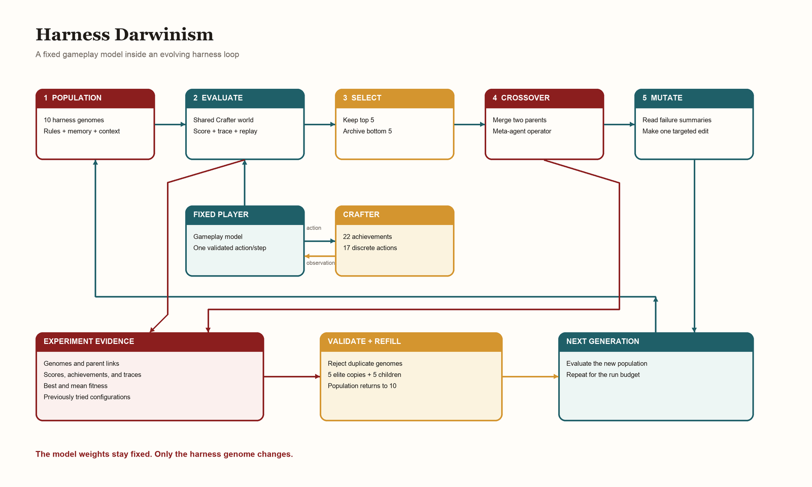
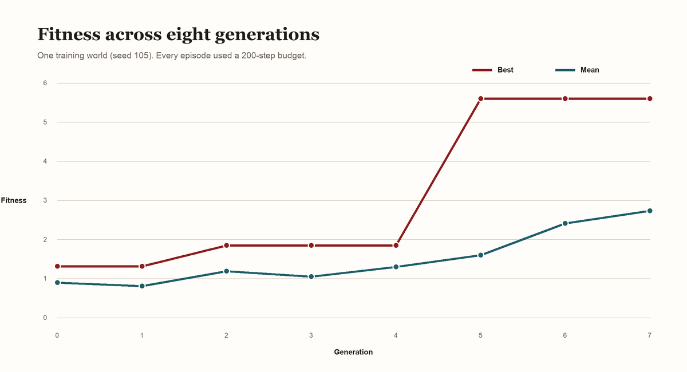
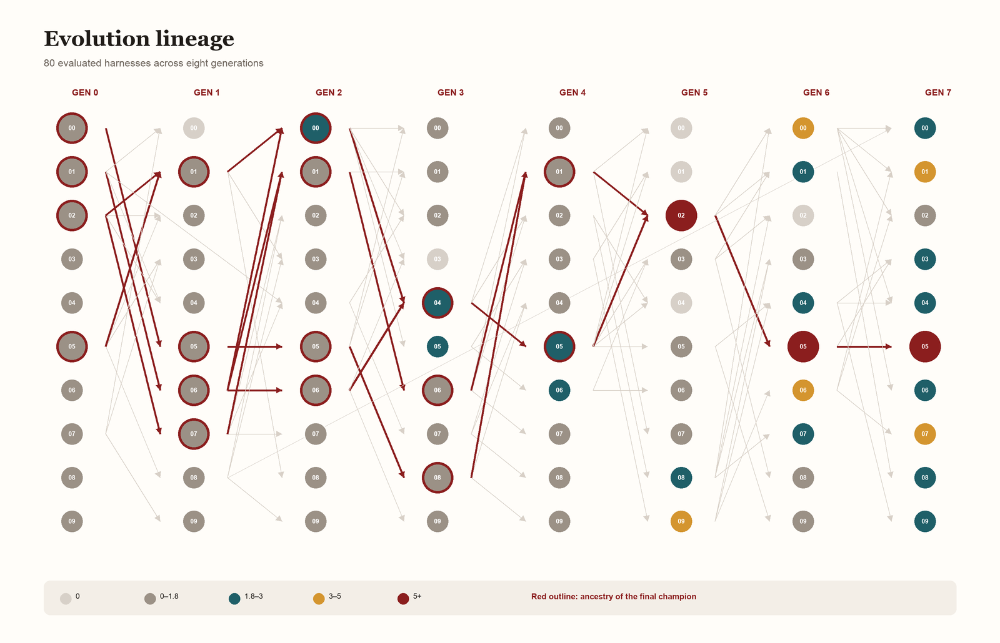
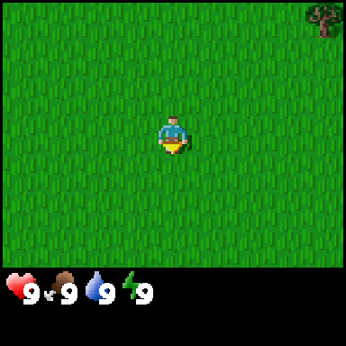

# Harness Darwinism: Evolving Agent Harnesses with Genetic Algorithms

**Suryaprakash Senthil Kumar and Subrahmanyam Arunachalam**

## Abstract

Harness Darwinism treats an agent harness as a genome. It applies selection, crossover, and mutation while keeping the gameplay model fixed.

Each harness was a genome. Its genes were the prompt, rules, memory policy, tools, and context budget. Ten genomes played Crafter. The best five survived. A meta-agent bred five children.

At a fixed budget of 85 actions, best fitness rose by 41.1%. Mean fitness rose by 44.2%. A later 200-action phase reached a training score of 5.606 and nine unlocked achievements.

The experiment used one training world. It did not include held-out evaluation. The result shows a working evolution loop and a measurable training gain. It does not show generalization.

## 1. Introduction

Many agent systems store past trials in a separate memory. They retrieve useful lessons into working context when a similar task appears. The model weights stay fixed, but the next attempt receives better evidence.

This raises a broader question: if an agent can inherit memories, can it also inherit a better harness?

The project began during the Harness Engineering and Model Wrangling Hackathon. We used its recursive self-improvement theme to test this question in Crafter.

We treated the harness as a genome. Each genome described the rules, memory policy, action interface, and context budget used by one agent. A population of genomes competed on the same task.

The environment supplied a fitness score. High-scoring genomes survived. A second model combined two parents and made one mutation based on their failures.

We call this system **Harness Darwinism**. It applies a genetic algorithm to recursive harness improvement while the underlying gameplay model remains fixed.

Our experiment ran for eight generations in Crafter. We used ten candidates per generation, retained five elites, and produced five children through crossover and mutation.

Within the controlled 85-action phase, best score increased from 1.314 to 1.854. The 200-action phase later reached 5.606, but that phase cannot be compared directly with the shorter episodes.

## 2. Related Work

Reflexion stores verbal feedback in episodic memory, while ExpeL extracts lessons from prior tasks and recalls them later. Both improve future decisions without changing model weights [2, 3]. Our method changes the harness itself.

Genetic algorithms use selection, crossover, and mutation [4]. The Darwin Gödel Machine evolves coding agents and keeps a lineage archive [5]. We use generations, two-parent crossover, and typed harness genomes.

## 3. Methodology

### 3.1 Genetic algorithm

A genetic algorithm starts with a population of candidate solutions. Each candidate has a genome that defines its behavior.

The method has five main stages:

1. **Initialization:** Create a varied starting population.
2. **Fitness evaluation:** Run every candidate and assign a score.
3. **Selection:** Retain candidates with higher fitness.
4. **Crossover:** Combine traits from two selected parents.
5. **Mutation:** Make a small change that can produce a new behavior.

The next population contains survivors and children. Repeating this cycle searches the genome space without testing every possible genome.

### 3.2 Our method

In Harness Darwinism, each agent harness is represented as one genome. The genome contains fields that the evolution loop can change and validate.

```json
{
  "system_prompt": "You are a Crafter survival agent...",
  "rules": [
    "Collect wood before anything else.",
    "Place a crafting table early."
  ],
  "memory_policy": {
    "type": "notes",
    "max_items": 20
  },
  "context_budget": {
    "history_steps": 10
  }
}
```

The gameplay model receives this genome with the current observation. It returns one validated Crafter action. The model and its sampling settings remain fixed across candidates.

The meta-agent receives two selected genomes. It produces a typed child configuration and a note that explains which traits it retained.

The meta-agent then reads failure summaries from the two parents. Each summary contains the termination reason, step count, and unlocked achievements. It proposes one targeted mutation.

The system records every genome, run, score, parent link, crossover note, mutation note, and tried configuration hash. This evidence makes the search resumable and keeps its lineage visible.



### 3.3 Initialization

Generation 0 used ten hand-written starter rules. They covered resource collection, tool crafting, health, water, sleep, combat, and furnace construction.

Each initial genome received a random subset of one to five rules. This created ten different harnesses without asking the meta-agent to design the first population.

The starting pool was small and simple. This limited the search because later genomes could only combine those rules or add strategies that the mutation model inferred from failures.

### 3.4 Fitness function

Crafter tracks 22 achievements. We computed the standard Crafter score from achievement success rates:

```text
score = exp(mean(log(1 + 100 × achievement_rate))) - 1
```

All candidates in one generation played the same world. This reduced within-generation noise and made selection consistent.

Our run used one world per generation. With one episode, each achievement rate was either zero or one. This produced a valid training signal, but it was a weak estimate of general performance.

### 3.5 Selection and elitism

We ranked ten candidates by fitness. The top five became survivors. The bottom five moved to the archive.

Each survivor was copied into the next generation. This elitism step protected strong genomes from poor children. It also explains why some nodes in the lineage have one parent and no crossover.

### 3.6 Crossover

Parent pairs were sampled with fitness-based weights. The system could also select an archived genome with a small probability to restore diversity.

The meta-agent merged complementary rules, memory settings, and context budgets. The output had to match the genome schema. Invalid output was retried up to three times.

### 3.7 Mutation

After crossover, the meta-agent read failure summaries from both parents. It added, removed, or changed one rule. It could also adjust the memory policy or context budget.

A global ledger stored the hash of every tried configuration. Duplicate mutations were retried three times. A deterministic context-budget change acted as the final novelty fallback.

Five elite copies and five children formed the next population. The active population therefore remained fixed at ten.

## 4. Experiments

### 4.1 Crafter environment

Crafter is a 2D survival game with a procedurally generated world. The agent collects resources, manages health and energy, fights enemies, builds stations, and crafts better tools [1].

The action space has 17 discrete actions. Evaluation covers 22 achievements, from collecting wood to crafting advanced tools and finding diamond.

We optimized the geometric-mean Crafter score. This metric rewards progress across the full achievement set and gives extra value to achievements that few episodes unlock.

### 4.2 Experiment setup

| Setting | Value |
|---|---|
| Experiment | `demo-evolution-3` |
| Generations | 8, numbered 0–7 |
| Candidates per generation | 10 |
| Survivors per generation | 5 |
| Children per generation | 5 |
| Training worlds per generation | 1 |
| Training world | Seed 105 |
| Episode budget, Generations 0–4 | 85 actions |
| Episode budget, Generations 5–7 | 200 actions |
| Gameplay model | Claude Haiku 4.5 on Amazon Bedrock |
| Meta-agent | Claude Opus 4.6 on Amazon Bedrock |
| Persistence | MongoDB Atlas |

The gameplay model received a text observation of the world. It selected one allowlisted action at each step. The runner also captured rendered frames and produced a replay GIF.

The meta-agent did not play Crafter. It only performed crossover and mutation. This separation kept task execution and evolutionary search in different model calls.

Atlas used four collections. `harnesses` stored genomes and lineage. `runs` stored episode evidence. `metrics` stored generation scores. `ledger` stored configuration hashes.

### 4.3 Measurement protocol

We compared candidates only within the same episode budget. Generations 0–4 form the controlled 85-action phase. Generations 5–7 form the 200-action phase.

We did not run a paired held-out test. We therefore report training-world fitness and observed behavior. We do not report a generalization result.

## 5. Results

### 5.1 Fitness over generations



Generation 0 had a best score of 1.314 and a mean of 0.901. By Generation 2, best score reached 1.854. This was a 41.1% increase at the same 85-action budget.

Best score stayed at 1.854 through Generation 4. Mean score reached 1.299 in Generation 4, a 44.2% increase from Generation 0.

Generation 5 used 200 actions and reached 5.606. This jump includes a larger episode budget, so it is not evidence of a 202% evolutionary gain over Generation 4.

Within the 200-action phase, best score remained 5.606. Mean score rose from 1.606 in Generation 5 to 2.740 in Generation 7. This was a 70.6% increase in population mean.

The later generations improved population quality even though they did not find a better champion.

### 5.2 Lineage



The lineage contains 80 evaluated harnesses. Pale edges show all parent links. The red path shows the ancestors that led to the final champion.

Single-parent edges are elite copies. Two-parent edges are crossover children. This distinction prevents an inherited survivor from being described as a new crossover.

Candidate `g2_00` is one clear crossover example. Its parents scored 1.314 and 0.876. One parent had concise survival rules. The other had a detailed technology plan.

The crossover kept both traits. Mutation then added immediate stone mining, inventory checks, goal reassessment, and a larger history budget. The child scored 1.854.

This child changed several fields. The result does not prove that one rule caused the gain. A rule-level ablation would be required for that claim.

### 5.3 Observed behavior

Recorded replay evidence is available for Generations 3–5. The following examples show three measured candidates on world seed 105.



Candidate `g3_00` collected wood and placed a table. It did not reach stone tools. Its behavior spent much of the episode near the start of the technology tree.


Candidate `g4_05` collected wood, stone, and coal. It placed a table and made a wooden pickaxe. The action sequence showed a clearer resource-to-tool progression.


Candidate `g5_02` unlocked nine achievements. It collected wood, stone, coal, water, and a sapling. It made wooden and stone pickaxes and placed a table and furnace.

The last replay has a larger action budget. The three videos show observed behavior, but they are not a controlled causal comparison.

### 5.4 Rule evolution

The rules became more specific as the meta-agent saw failures.

| Stage | Example policy change | Score |
|---|---|---|
| Generation 0 | “Collect wood before anything else.” | Best 1.314 |
| Generation 2 | Mine stone after the wooden pickaxe; check inventory; reassess the next goal. | 1.854 |
| Generation 4 | Add step limits, milestone notes, and direct cave or downward search. | 1.854 |
| Generation 5 | Add anti-stall thresholds, survival thresholds, and a 25-step history window. | 5.606 |

The champion first appeared as `g5_02`. Elitism copied it to `g6_05` and then `g7_05`. The final two copies kept the same score and genome.

The final policy was also imperfect. One rule claimed that stone was always two to four blocks below the surface. That statement may fit seed 105, but it is not a safe rule for unseen worlds.

This is evidence of possible overfitting. Evolution can preserve a useful shortcut before it knows whether the shortcut generalizes.

### 5.5 Comparison with published Crafter results

CrafterDojo reports 31.8 for its strongest prior baseline and 61.4 for its large behavioral-cloning model [6]. The official Crafter scoreboard also lists humans at 50.5 [7].

Our score of 5.606 is much lower. It is also not directly comparable. Published results use different observations, training budgets, policies, and many evaluation episodes.

Our run used one training world and at most 200 actions per episode. Its purpose was to test harness evolution, lineage, and replay, rather than establish a Crafter benchmark result.

## 6. Conclusion

Harness Darwinism turned an agent harness into a searchable genome. Selection kept stronger policies. Crossover combined parents. Mutation used failure evidence. The system stored the complete history.

At a fixed 85-action budget, best fitness improved by 41.1% and mean fitness improved by 44.2%. The longer 200-action phase reached 5.606 and improved mean fitness by 70.6% across three generations.

The experiment had three main limits. It used one training world. It changed the action budget after Generation 4. It did not run a paired evaluation on unseen worlds.

API usage was another constraint. One 200-action episode could send more than two million input tokens because each action repeated recent history. Larger context genes increased both capability and cost.

The starter rules also limited the search. A stronger initial population could include navigation, spatial memory, recovery, and tool-use policies. The current pool mainly covered survival and the crafting sequence.

The next study should use several shared training seeds. It should freeze the champion, compare it with the initial harness on paired held-out seeds, and remove one evolved rule at a time.

The experiment did not reach the published Crafter scores. It showed that a fixed model can produce better training behavior when the harness becomes the object of evolution.

The experiment also exposed an evaluation requirement. Generating another prompt is easy. Retaining enough evidence to determine whether that prompt is better is harder.

## References

1. Danijar Hafner. [Benchmarking the Spectrum of Agent Capabilities](https://arxiv.org/abs/2109.06780), 2021.
2. Noah Shinn et al. [Reflexion: Language Agents with Verbal Reinforcement Learning](https://arxiv.org/abs/2303.11366), 2023.
3. Andrew Zhao et al. [ExpeL: LLM Agents Are Experiential Learners](https://arxiv.org/abs/2308.10144), 2023.
4. A. E. Eiben and J. E. Smith. [Introduction to Evolutionary Computing](https://doi.org/10.1007/978-3-662-44874-8), 2015.
5. Jenny Zhang et al. [Darwin Gödel Machine: Open-Ended Evolution of Self-Improving Agents](https://arxiv.org/abs/2505.22954), 2025.
6. Junyeong Park, Hyeonseo Cho, and Sungjin Ahn. [CrafterDojo](https://arxiv.org/abs/2508.13530), 2025.
7. Danijar Hafner. [Crafter repository and official scoreboard](https://github.com/danijar/crafter), accessed October 2026.
