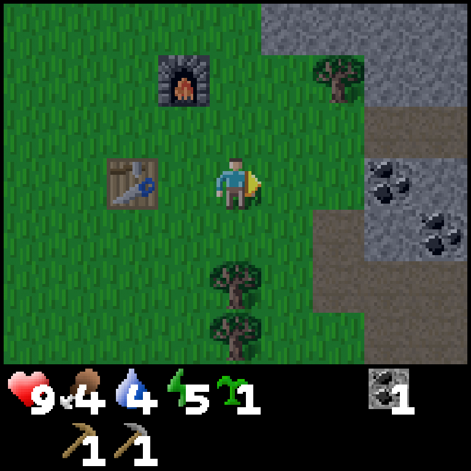

# Harness Darwinism: What Happened When We Let Agent Rules Evolve

**Suryaprakash Senthil Kumar and Subrahmanyam Arunachalam**

During a hackathon, our team of three built a system called Harness Darwinism. The idea came from genetic algorithms. We started with a population of agent configurations. We evaluated them, kept the stronger configurations, and used them to create the next generation.

We did not train or fine-tune the gameplay model. We kept the model fixed. We changed the harness around it: the system prompt, rules, memory policy, and amount of recent history.

The final experiment ran for eight generations in Crafter, a small 2D survival game. The best harness reached a score of 5.606 on our training world. More important, the experiment showed us which parts of this approach worked, where it failed, and how quickly context costs can grow.


## 1. The hackathon question

The hackathon theme was recursive harness improvement. The question was direct: how can an agent improve the system around the model as it collects more experience?

A harness includes the instructions, tools, memory, and control logic that surround a model. Most applications treat this harness as fixed code. A developer writes a prompt, selects a memory strategy, and adjusts it by hand.

We wanted to treat the harness as a search problem.

Our initial question was:

> If several harnesses play the same game, can we select the better ones and use their failures to create stronger harnesses?

This is where the genetic algorithm came in.

## 2. From genetic algorithms to agent harnesses

We mapped the standard parts of a genetic algorithm to the agent system.

| Genetic algorithm | Harness Darwinism |
|---|---|
| Genome | System prompt, rules, memory policy, and context budget |
| Individual | One harness configuration |
| Population | Ten harness candidates |
| Environment | Crafter |
| Fitness | Crafter achievement score |
| Selection | Keep the five strongest candidates |
| Elitism | Copy those five candidates to the next generation |
| Crossover | Ask a meta-agent to combine two parent harnesses |
| Mutation | Ask the meta-agent for one targeted change |
| Archive | Keep eliminated candidates and their evidence |

One term caused confusion while we built the system. A candidate is not a seed. A candidate is a genome or harness configuration. A seed identifies the generated Crafter world. We used world seed 105 for the main experiment.

## 3. What was inside a genome?

Each genome contained four main parts:

```json
{
  "system_prompt": "You are a Crafter survival agent...",
  "rules": [
    "Collect wood before anything else.",
    "Place a crafting table early."
  ],
  "memory_policy": {
    "type": "notes",
    "max_items": 20
  },
  "context_budget": {
    "history_steps": 10
  }
}
```

The `rules` field gave the gameplay model a strategy. The memory policy controlled retained notes. The context budget controlled how many recent gameplay turns returned to the model on each call.

We used Claude Haiku 4.5 as the fixed gameplay model. It received the current observation, retained history, memory notes, and the genome rules. It returned one Crafter action.

We used Claude Opus 4.6 as the meta-agent. It never played the game. It combined parent genomes and proposed mutations.

Generation 0 used a pool of ten hand-written starter rules. Each of the ten candidates received a random subset of one to five rules. This gave us a varied starting population.

## 4. Why we used Crafter

Crafter is a 2D survival environment that looks like a small version of Minecraft. The player collects resources, manages health and energy, fights enemies, and crafts better tools.

Crafter measures 22 achievements. These achievements include collecting wood, placing a table, crafting pickaxes, finding coal, building a furnace, and reaching iron or diamond.

It worked well for this project for three reasons:

1. The game provides an automatic fitness signal.
2. Short episodes make repeated evaluation possible.
3. A replay makes the agent's behavior easy to inspect.

The last point mattered during the demo. A score chart tells one part of the story. A replay shows whether the agent follows its rules or wastes its steps.

## 5. How one generation worked

Each generation had ten candidates. The loop had four phases.

### Phase 1: Evaluate

Every candidate played the same Crafter world. This kept the comparison within a generation consistent. We stored the score, achievements, actions, token usage, termination reason, and replay.

### Phase 2: Select

We ranked the ten candidates by fitness. The top five became survivors. The other five moved to the archive.

The system copied each survivor into the next generation. This is elitism. A strong candidate could survive even when every new child performed poorly.

### Phase 3: Crossover and mutation

The system selected parent pairs with fitness-weighted sampling. It sometimes selected an archived candidate to add diversity.

Opus then received both parent configurations. It produced one crossover configuration and explained which traits it kept.

Next, Opus received failure summaries from the selected parents. A summary contained the termination reason, step count, and unlocked achievements. Opus used this evidence to propose one targeted mutation.

### Phase 4: Refill

Five survivors and five children formed the next population. The population always returned to ten candidates.

The complete loop was:

```text
10 candidates
    ↓ evaluate
rank by fitness
    ↓ select
5 survivors
    ├── copy forward as elites
    └── select parent pairs
            ↓
       crossover + mutation
            ↓
         5 children
            ↓
next population of 10
```

## 6. How failure became input

The useful part of this design was not only the selection of high scores. The system also used evidence from weak runs.

One early agent crafted a wooden pickaxe but did not continue to stone tools. Its mutation added more direct instructions:

- Mine stone immediately after crafting the wooden pickaxe.
- Do not repeat completed actions.
- Check the inventory before collecting more material.
- Reassess the next unfinished achievement after each action.

The mutation also increased `history_steps` from 12 to 16. The model could then see more of its recent decisions.

This did not mean that every failed candidate contributed to every mutation. The current implementation used failure summaries from the two selected parents. Archived candidates could also return through parent selection.

## 7. MongoDB was the experiment memory

MongoDB Atlas stored the state of the evolutionary process. We used four collections.

| Collection | Stored data |
|---|---|
| `harnesses` | Genome, generation, parents, fitness, crossover note, and mutation note |
| `runs` | Episode score, achievements, actions, usage, failure summary, and replay path |
| `metrics` | Best and mean score for each generation |
| `ledger` | Hashes of previously attempted configurations |

This design gave us two practical features.

First, we could trace a child back to both parents. The dashboard showed the selected parents, crossover output, mutation, final rules, and score.

Second, we could resume an interrupted experiment. A long run could reuse completed candidates instead of paying for the same evaluation again.

The ledger prevented the meta-agent from returning a configuration that we had already tested. This became important after several generations, when the population began to converge.

## 8. What the results showed

The experiment ran through Generation 7. We used ten candidates, five survivors, and one training world per generation.

We also changed the episode budget during the run. Generations 0–4 used 85 steps. Generations 5–7 used 200 steps. The two phases must be read separately.


### The 85-step phase

Generation 0 had a best score of 1.314 and a population mean of 0.901.

By Generation 2, the best score reached 1.854. That is a 41% increase. The best score then stayed at 1.854 through Generation 4.

The population mean reached 1.299 in Generation 4. This was a 44% increase from Generation 0.

### The 200-step phase

Generation 5 produced a new best score of 5.606. This result is not directly comparable with the 85-step phase because the candidate received more actions.

The 200-step phase still gave us a useful comparison of Generations 5–7. The best score stayed at 5.606. The population mean increased from 1.606 to 2.740.

So the later generations did not produce a better champion. They improved the overall population. More candidates reached the middle of the technology tree instead of failing at the first few achievements.

The champion unlocked nine achievements. It collected wood, stone, coal, water, and a sapling. It placed a table and furnace. It also crafted wooden and stone pickaxes.

## 9. One lineage that changed the behavior

Candidate `demo-evolution-3_g2_00` provides a clear example.

Its parents scored 1.314 and 0.876. The crossover kept survival rules from one parent and technology-tree rules from the other.

The mutation then added explicit stone progression, inventory checks, and goal reassessment. It increased the history budget from 12 to 16 turns.

The child scored 1.854. It collected wood, stone, and coal. It also placed a table and crafted a wooden pickaxe.

This example does not prove that one rule caused the improvement. The child changed several fields at the same time. A controlled rule ablation would be necessary for that claim.

Still, the lineage gave us a useful account of what changed and why the meta-agent changed it.

## 10. The final rules

The Generation 7 champion inherited the configuration first found in Generation 5. Its strongest patterns were simple:

1. Move through the tool tiers without delay.
2. Dig down for stone instead of wandering across the surface.
3. Use step thresholds to detect stalled progress.
4. Check inventory before repeated collection or crafting.
5. Record the next three actions after each crafting milestone.
6. Manage food, water, energy, and night safety before they become emergencies.

The full champion had nine detailed rules and retained 25 history steps. Some rules were too long. Some also made claims about the world that need more testing. For example, the champion stated that stone was always two to four blocks below the surface.

This is another reason to evaluate on unseen worlds. A useful rule on seed 105 can become a bad rule elsewhere.



## 11. What broke during the build

The evolution loop exposed several engineering problems.

### Invalid crossover output

The meta-agent sometimes returned text that did not match the required JSON schema. The first version accepted one attempt and then copied Parent A.

We changed crossover to retry three times. Each retry told the model why the previous response was invalid. The system now records the attempt count or the final fallback.

### Duplicate mutations

The meta-agent sometimes proposed the same effective genome three times. This happened when strong parents had similar rules and the failure evidence suggested the same fix.

After three duplicate mutations, the system used a deterministic fallback. It changed the history budget to the nearest unused value. The mutation note stated that this was a fallback, not an LLM decision.

### Interrupted evaluations

Long episodes made interruption likely. We added resume logic that checked each candidate and seed. Completed runs were reused. Missing runs continued from the same stored generation.

### Missing visual evidence

The first generations saved scores but did not record gameplay frames. We added frame capture and GIF generation for later episodes. This made every new candidate inspectable from the dashboard.

### Context cost

A 200-step episode could use more than two million input tokens. Each action included the observation and recent interaction history. A larger `history_steps` value increased the prompt on every later action.

This made context budget a real gene. It affected behavior, latency, and cost at the same time.

## 12. What this experiment did not prove

This was a hackathon experiment, not a benchmark result.

The main limitations were:

- We trained and measured on one Crafter seed.
- We did not complete a paired evaluation on unseen seeds.
- We changed the episode budget after Generation 4.
- We did not run rule-by-rule ablations.
- We did not compare against random mutation or hill climbing.
- Early meta-agent calls did not persist token usage.

Because of these limits, we cannot claim that the champion generalizes. We can claim that the system completed selection, crossover, mutation, evaluation, lineage storage, resume, and visual replay.

## 13. What we would do next

The next experiment should use several shared training seeds per generation. After evolution, we should freeze the champion and compare it with the original harness on unseen paired seeds.

We would also make four changes:

1. Add cost to the fitness function.
2. Track meta-agent tokens for every crossover and mutation.
3. Add diversity pressure so similar candidates do not take over the population.
4. Remove one champion rule at a time and measure the score change.

These changes would answer the question that the hackathon run could not answer: did evolution create a harness that works better outside one world?

## 14. Final thoughts

We presented Harness Darwinism at the hackathon, but the project was not selected. I still liked the result because the system worked from end to end.

The model weights stayed fixed. The rules, memory policy, and context budget became the search space. The game supplied the fitness signal. MongoDB stored the history of the search. A second model acted as the genetic operator.

The best score did not increase in every generation. Evolution also converged and repeated itself. These were useful results, not failures to hide.

The main lesson was simple: an agent harness can be treated as an object that we evaluate, compare, inherit, and change. The difficult part is not generating another prompt. The difficult part is keeping the evidence clean enough to know whether the new prompt is better.

## References

1. Danijar Hafner. [Benchmarking the Spectrum of Agent Capabilities](https://arxiv.org/abs/2109.06780), 2021.
2. Jenny Zhang, Shengran Hu, Cong Lu, Robert Lange, and Jeff Clune. [Darwin Gödel Machine: Open-Ended Evolution of Self-Improving Agents](https://arxiv.org/abs/2505.22954), 2025.
3. Cerebral Valley. [The Harness Engineering & Model Wrangling Hackathon](https://cerebralvalley.ai/e/mongodb-sftw-hackathon).
4. Project repository: [Harness Darwinism](https://github.com/Subrahmanyam2305/harness-darwinism).
