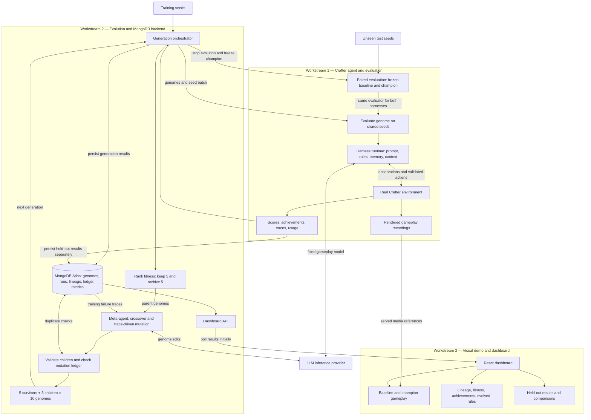

# Harness Darwinism system design

The gameplay model stays fixed while harness configurations evolve. This diagram
shows the intended system, grouped into the three workstreams.

Each generation evaluates all 10 genomes on the same training seed batch. The
orchestrator records results, retains the top 5, archives the rest, and produces
5 validated children using crossover and failure-informed mutation. The process
repeats until the configured stopping condition is reached.

After evolution, the frozen baseline and champion play the same unseen test
worlds. Test results and traces never feed back into evolution. The dashboard
shows real gameplay alongside performance, achievements, and lineage. Additional
experimental arms use the same evaluation path.

Agree on evaluator results, database schemas, and API response contracts before
parallel implementation. The backend can use a stub evaluator and the dashboard
can use labeled API fixtures while real gameplay is developed.

The current implementation includes evolution, MongoDB persistence, API routes,
and dashboard polling. LLM gameplay verification, recording delivery, complete
trace and usage persistence, and paired held-out reporting remain integration
work. Recordings must preserve gameplay randomness around extra renders.
